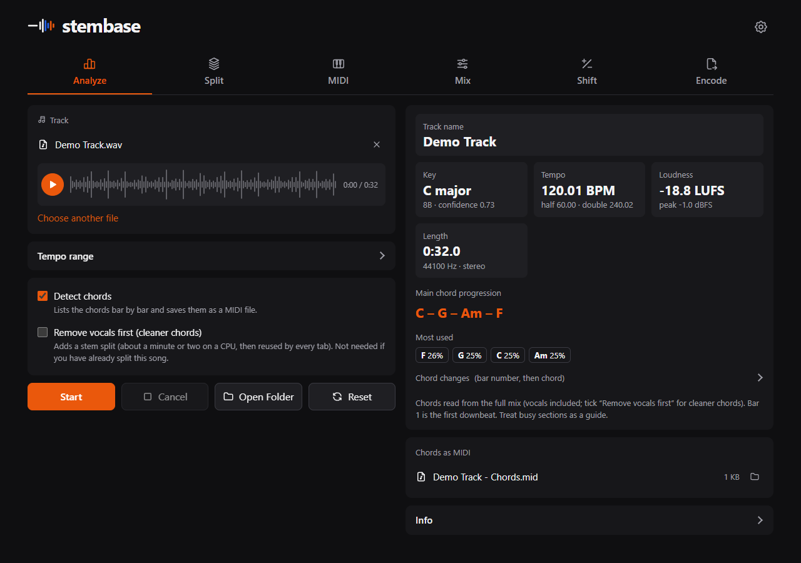
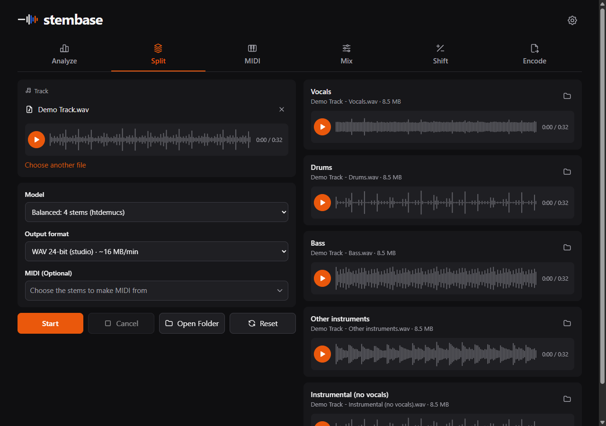
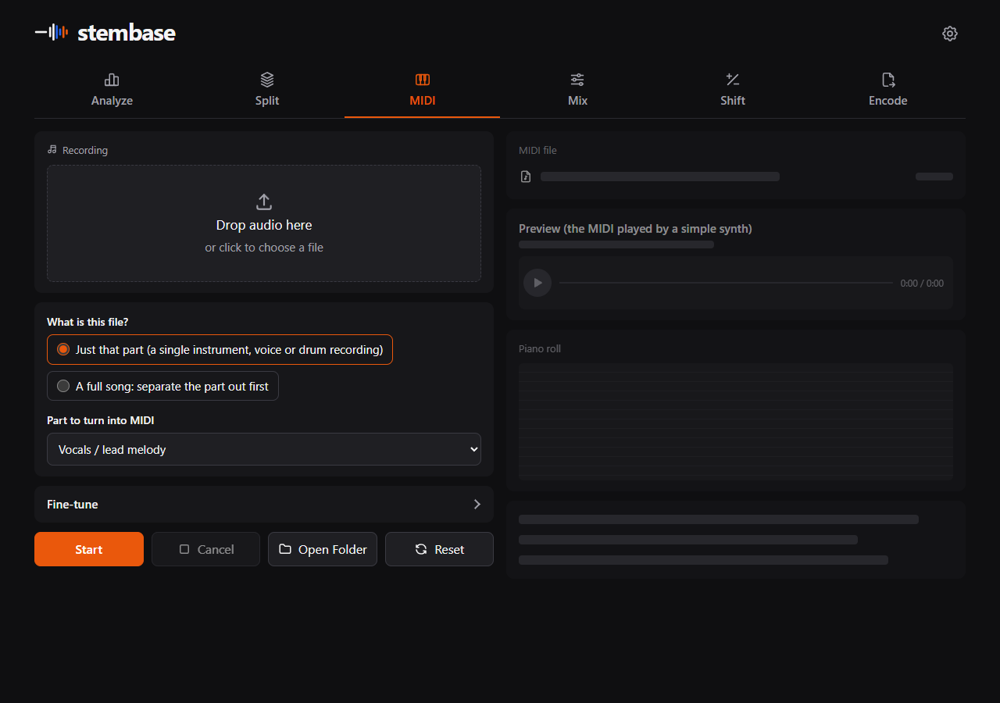

# Stembase

A desktop app for Windows, macOS and Linux that analyzes music, splits songs into stems, turns audio into MIDI, makes
mashups, changes key or tempo and converts audio files. Everything runs on your computer: nothing is uploaded, and no
internet connection is needed (the separation models are included).



## Install
| System | Installer | Notes |
|---|---|---|
| **Windows** 10 / 11 (64-bit) | `Stembase_<version>_x64-setup.exe` | Installs for your user without an admin prompt. Uses Edge WebView2 (built into Windows 11 and current Windows 10). |
| **macOS** 11 or later | `Stembase_<version>_aarch64.dmg` (Apple Silicon) or `_x64.dmg` (Intel) | Drag Stembase to Applications. Until the app is signed with an Apple Developer ID, open it the first time with right-click → Open. |
| **Linux** (64-bit) | `Stembase_<version>_amd64.AppImage` or `.deb` | AppImage: make it executable and run it. `.deb`: `sudo apt install ./Stembase_<version>_amd64.deb`. Needs WebKitGTK 4.1 (Ubuntu 22.04+, Debian 12+, Fedora 38+). |

Uninstalling keeps your results.

## Tabs
| Tab | What it does |
|---|---|
| **Analyze** | Key with Camelot code and confidence; tempo (fitted to 0.01 BPM) with half and double time; loudness (LUFS) and peak; length and format; first beat, downbeat and phrase start. **Chords**: the main progression, the most used chords and every chord change by bar number, also saved as a MIDI file (tick *Remove vocals first* for cleaner chords). |
| **Split** | Vocals, drums, bass and other instruments, plus an instrumental (everything except the vocals). The 6-stem model adds guitar and piano; the best-quality model is slower and cleaner. Optionally makes **MIDI** from any of the stems. |
| **MIDI** | Turns a vocal, bass line, piano, guitar, chords or drums into a MIDI file at the song's tempo, from a recording of just that part or from a full song (the part is separated out first). A synth preview and a piano roll to check the result. |
| **Mix** | Vocals from one song over the music of another: key-matched, tempo-matched, with vocal sections placed on the instrumental's phrases. Saves the mix plus aligned stems. |
| **Shift** | Shift by semitones and/or set a target BPM (the current tempo is detected for you). |
| **Encode** | Convert any number of files between WAV, AIFF, FLAC, MP3, Opus and Ogg Vorbis, or fit each file into a size in MB. |

| Split: five stems, each with its own player | MIDI before a job: the right side shows what will appear |
|---|---|
|  |  |

Drop files anywhere on a tab's drop zone, or click it to choose. Every job shows its progress in a window, then
confirms where it saved the result. If you load a file that was already processed, Stembase says so and offers the folder.

**Output format**: Split, Mix and Shift each have their own, starting from the default set in Preferences: WAV 32-bit
float / 24-bit / 16-bit, FLAC 24 / 16-bit, or MP3 320 / 192 / 128 kbps. Encode has its own list of formats. Supported
input: WAV, MP3, FLAC, OGG, Opus, AIFF. Under each tab: **Start**, **Cancel** (stops the running job), **Open Folder**
(where that tab saves) and **Reset** (clears the tab).

## Settings menu (⚙)
| Item | Shortcut (⌘ on a Mac) | |
|---|---|---|
| Check For Updates | Ctrl+U | Downloads, installs and reopens a newer Stembase, signed by its maker |
| Preferences | Ctrl+, | Theme (Dark, Light or Follow system), Output folder (Change…, Open, Use Default), default format, processor (Automatic, GPU or CPU), check for updates when Stembase opens |
| Keyboard Shortcuts | Ctrl+? | Also: Ctrl+1…6 tabs, Ctrl+O choose a file, Ctrl+Enter start the job, Ctrl+Shift+R open the Output folder, Esc close |
| About Stembase | | Version, links, Output and log folders |
| Quit Stembase | Ctrl+Q | Asks first while a job is running |

## Where files go
Everything is saved in the **Output** folder, **Music/Stembase** unless you choose another in Preferences (new results go there; earlier ones stay put): `<song>/Stems (<model>)/` for stems, `<song>/MIDI/` for MIDI,
`Mashups/<A x B>/` for mashups, `<song>/` for key/tempo changes, `Converted/` for conversions. Full-quality stems are
cached in a hidden `.cache` folder inside each song's folder, so re-exporting or reusing a song is instant; delete that
folder to free space.

The engine's log is `engine-log.txt` in `%LOCALAPPDATA%\Stembase` (Windows), `~/Library/Application Support/Stembase`
(macOS) or `~/.local/share/Stembase` (Linux). About → Open Log Folder opens it.

## Speed
Stem separation runs on the graphics card when Stembase finds one, otherwise on the CPU. Preferences → Processing
chooses **Automatic** (the graphics card, falling back to the CPU if it fails), **GPU** or **CPU**.

- **Windows:** any DirectX 12 graphics card (AMD, Intel or NVIDIA) through Microsoft's DirectML. Measured on an AMD
  Radeon RX 6950 XT: about 1.9× faster than the CPU for Balanced and 1.4× for Best quality; the first job after opening
  Stembase spends a few extra seconds warming up the card.
- **NVIDIA with CUDA:** much faster still, when the engine is built with a CUDA build of PyTorch.
- **CPU:** roughly 1–2 minutes per song for Balanced on a modern CPU, about four times that for Best quality.

Analysis, MIDI transcription, key/tempo changes and conversion run on the CPU.

## For developers
```
server.py              the audio engine as a local web API (token-protected, one job at a time)
engine/                analysis, separation, chords, MIDI, mashup, key/tempo, conversion, "done before" checks
ui/                    the Tauri app: src/ (React interface), src-tauri/ (Rust shell that starts and stops the engine)
branding/              the logo (T1e) as SVG, and make_icon.py for the app icon
stembase_engine.spec   PyInstaller recipe for the engine, bundled into the app
build.py               builds the engine, the app and the installer for the current system
models/                Demucs models (htdemucs, htdemucs_ft, htdemucs_6s); not in git
legacy/                the old Gradio interface of Stem Studio 1.x, for reference only
```

- **Packages:** in a `.venv` in the project folder (`build.py` uses it when it exists): `python -m venv .venv`, then with its Python `pip install -r requirements.txt pyinstaller` and `pip install --no-deps basic-pitch==0.4.0`, then `cd ui && npm install`. On Windows this brings `torch-directml`, which needs PyTorch 2.4, hence the separate environment.
- **Run from source:** `cd ui && npx tauri dev`. It runs `python server.py` for the engine.
- **Interface in a browser** (no Tauri): run `STEMBASE_TOKEN=dev python server.py`, note the port it prints, run `npm run dev` in `ui`, and open `http://localhost:1420/?port=<port>&token=dev`. File paths are pasted in place of the file dialog.
- **Build the installer for this system:** `python build.py` (`--app` reuses the engine already built). Installers land in `ui/src-tauri/target/release/bundle/`. PyInstaller can't cross-compile, so each system builds its own.
- **All three systems at once:** the GitHub Actions workflow `.github/workflows/build.yml` builds Windows, macOS (Apple Silicon and Intel) and Linux on GitHub and publishes a release with `latest.json` for Check For Updates. Its header lists the one-time setup (signing-key secret and a `models` release).
- **Update signing:** updates are signed with `~/.tauri/stembase.key` (keep it private and backed up: without it, installed copies can't be updated). Its public half is in `ui/src-tauri/tauri.conf.json`. The app checks `https://github.com/donnysaengkio/stembase/releases/latest/download/latest.json`; change that URL there if the repository has another name.
- **Rename the app:** `APP_NAME` in `engine/meta.py`, `productName` in `ui/src-tauri/tauri.conf.json`, and `name` in `ui/package.json`.

## Built with
Tauri and React (app), Demucs (Meta, stem separation), Basic Pitch (Spotify, audio to MIDI), librosa (analysis),
Pedalboard / Rubber Band (time-stretch and pitch-shift), pyloudnorm (loudness), FastAPI and uvicorn (engine API),
Tabler Icons, PyTorch and PyInstaller (packaging).

## Copyright
Only release stems, mashups or edits of music you have the rights to.
